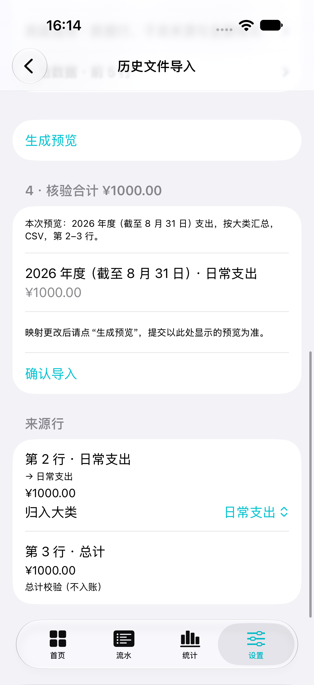
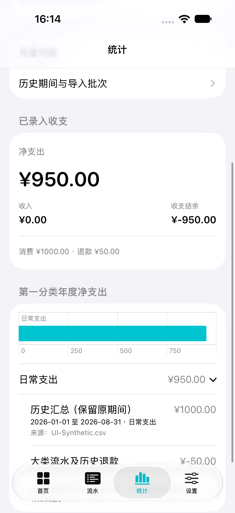
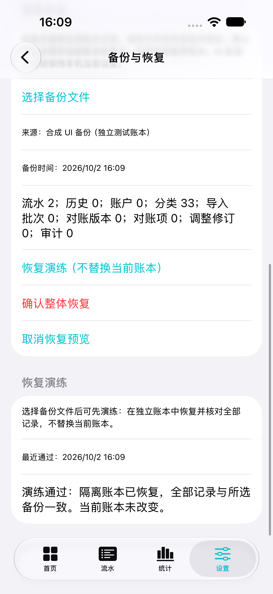

# P1 / P2 功能更新

更新日期：2026-10-02。历史口径保持第一分类年度汇总，2026 年覆盖 1 月 1 日至 8 月 31 日，不导入历史月汇总。

## P1

### 年度大类统计

统计 → 年度，分类图和精确列表统一归并到第一分类。展开某大类可查看原期间历史合计、来源文件及各子类日常净支出与有效调整。大类退款作为大类流水展示，不分摊到子类。各大类合计与年度净支出相等；只有查询范围完整包含历史期间时才纳入对应历史金额。

### 导入向导与核验

历史导入按“选择文件 → 年份及实际覆盖 → 第一分类与年度金额 → 核验合计”呈现。支持第一分类、年度金额两列表；读取已识别的表头设置默认列，用户仍需核对。子类来源、行范围和金额格式移入高级选项。原始数据前五行、来源行到目标大类的映射及原有错误、重复、总计校验均保留。

### 备份状态及恢复演练

设置 → 备份与恢复显示最近成功导出时间、该文件的快照时间，以及当前账本相对该快照新增、修改、删除的记录数量（包括基础资料和审计）。只有系统导出成功才更新状态；取消、失败不更新，文件选择期间的新变更仍计为未备份差异。

提醒为应用内提醒，可选每 7 天、每 30 天或关闭；不依赖系统通知。首页显示到期提示。时间及记录指纹按本机账本作用域保存，独立测试账本隔离，重启后保留。

选择备份文件后可以执行“恢复演练”：在隔离的内存账本里运行完整恢复，重新导出并逐项比对，再清理临时演练恢复点。当前账本和备份成功状态不变。此操作验证逻辑备份可恢复，不替代物理断电或存储损坏测试。

## P2

### 快捷记账

新建流水记住最近有效账户与同类型最近分类；常用分类提供快捷选择。停用的账户和分类不会自动套用。编辑现有记录仍保留其原有字段。支持“保存并继续”，保存后清空金额、备注，保留选择的日期。

常用模板保存类型、金额、分类、账户、备注，不保存日期；使用时带入当天，可再次编辑后确认。最多保存 20 个，可删除。模板不会自动记账，已停用的分类或账户会清空要求核实。模板、最近选择和备份提醒是本机偏好，不进入账本完整备份。

设置 → 分类 → 调整分类顺序，支持同级第一分类和子类的拖动排序。排序保存在账本中并参与完整备份，不改变历史归属。

### 月度覆盖视图

月度对账 → 年度月份与分类覆盖，查看一年十二个月，并逐大类展示历史未拆分、未提供依据、待核对或已核对分类数量。未提供不当作零；部分分类已核对不宣称整月完整，已核对可能仍有保留差异。可进入对应月份的对账详情，或创建该月依据。

### 历史消费退款

记一笔 → 退款 → 历史消费，选择有效历史汇总、填写金额、到账日期、到账账户（可未指定）、凭据说明和原因。凭据说明是退款单号或可追溯说明文字，目前不上传附件。

- 来源必须为有效、有批次的历史支出汇总；退款日期必须晚于其截止日。
- 累计退款不得超过对应历史合计。历史没有单笔明细，无法核验每个订单的原价，因此须依据实际退款凭据人工核实。
- 退款按实际到账月份及原大类冲减净支出，保留原历史金额，绝不伪造历史逐笔消费。
- 保存、编辑、跨月移动和删除使受影响月份重新待核对。有退款引用时禁止撤销原历史批次；处理关联退款后才可撤销。
- 大类退款无法按子类分摊，对应子类净支出对账禁止产生差额或新增调整。允许填写原因将旧调整归零；确认核对时仍需说明保留差异。消费总额口径不受退款影响。
- 每次保存保留凭据审计快照；删除流水后保留既有快照。完整备份和流水 CSV 包含来源及凭据说明。

存储复用原退款的 `originalEntryID`：普通退款引用逐笔支出，历史退款引用历史汇总。凭据快照作为 `historicalRefund` 审计关联历史汇总，不改变 SwiftData Schema。含这种审计的 JSON 备份使用格式版本 2；当前程序兼容版本 1 和 2，旧程序会拒绝版本 2，避免静默丢失退款关系。

## 界面截图

以下截图来自独立模拟器测试账本，金额均为合成数据。

| 年度导入核验 | 年度大类展开 | 隔离恢复演练 |
| --- | --- | --- |
|  |  |  |

[查看月份分类覆盖截图](previews/p2-month-coverage.png)。

## 验证记录

本轮模拟器单元测试 63 项通过（新增 9 项），覆盖年度归并、两列映射、历史退款日期/凭据/上限、备份和 CSV 往返、关联撤销、跨月核对失效、覆盖状态、备份快照差异、恢复演练隔离、快捷选择/模板/排序。

界面测试分批执行，共 12 项取得通过结果（包含新增 2 项）。首轮发现的首页近期记录、连续记账反馈位置问题已修复；测试中的输入光标、系统弹窗等待及合并无障碍标签定位也已修正，失败项目逐项复验通过。验证包括：

- 两列年度导入 1,000 元，2026 年覆盖至 8 月 31 日；随后历史退款 50 元，年度大类净支出为 950 元，8 月保留“历史未按月拆分”。
- 保存并继续、保存及复用模板、隔离恢复演练，演练后当前账本金额不变。
- 日常流水增删改与重启持久化、账户及收入、搜索统计、历史批次撤销、手工对账调整。
- AI 草稿确认与失败回退、配置持久化、CSV 导出取消与确认恢复，以及深色最大字号、金额键盘、日期选择。

本轮使用 iOS 27 模拟器和独立合成账本，未安装到真机，未以真实账单或真实 AI 服务验收，未验证最低支持的 iOS 18。结果包位于本机临时目录：`/private/tmp/lot-bill-p1p2-final.xcresult`（63 项单元测试及定向界面回归）、`/private/tmp/lot-bill-p1p2-annual-pass.xcresult`（年度导入完整界面流程）；首轮记录为 `/private/tmp/lot-bill-p1p2-ui.xcresult`。
