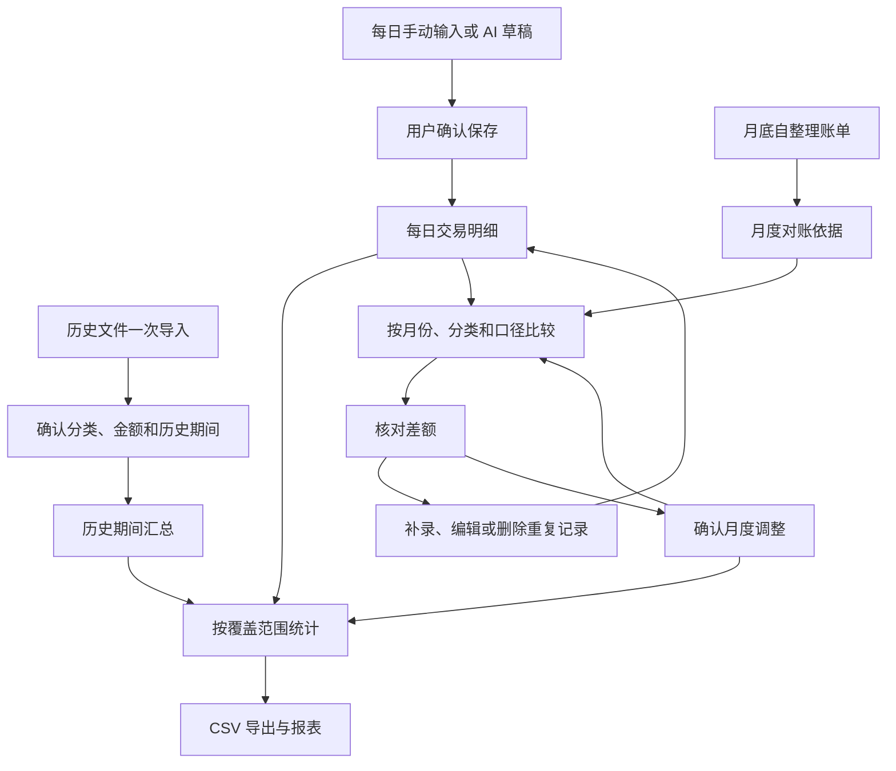

# Lot Bill：iOS 个人记账 App 整体方案

更新日期：2026-10-01  
文档状态：M1–M7 个人试用版已交付；真机验收、安装和未覆盖项见 [M7 记录](m7-acceptance.md)，分阶段证据见 [环境记录](environment.md)。导入格式见 [M3/M4 使用说明](import-format.md)，AI 与数据导出边界见 [M5/M6 使用说明](ai-and-data.md)  
配套文档：[开发计划](development-plan.md)

## 1. 产品目标与已确认需求

以每日记账为主要使用方式，将用户自己整理的历史账单一次性导入，在月底用自整理账单补充和核对当月记录。

开发验证约定：日常构建、调试和测试使用本机模拟器，最终验收阶段才使用真机。

已确认的产品约束：

1. iOS 原生开发，支持本地保存和离线维护。
2. 历史账单首次初始化时导入，后续以每日新增、修改、删除和补记为主。
3. 每日维护后，相关月份和年度的统计立即更新。
4. 月底账单是对账依据，确认差异后补录或修正，不直接重复累加到支出。
5. 首版处理用户自整理文件，暂不适配微信、支付宝及银行官方导出格式。
6. 支持配置 LLM 推理服务，用于一句话记账、分类建议及统计说明。
7. 支持将账单导出为本地 CSV，同时提供完整备份和恢复。

本方案不包含费用报价。苹果备忘录、远程文件源等早期设想作为后续扩展，不占用首版核心流程。

## 2. 首版范围

| 模块 | 首版交付内容 |
| --- | --- |
| 历史初始化 | 选择自整理 XLSX/CSV；指定期间、列映射和分类；预览；批量确认；防止重复导入；导入批次可撤销 |
| 每日记账 | 收入、支出、转账；日期、金额、账户、分类、备注；新增、编辑、删除和历史补记 |
| 分类维护 | 沿用样本的两级支出分类；可新增、重命名、排序、停用；保留历史关联 |
| 账户 | 用户手动创建现金、微信、银行卡等账户标签；区分支付渠道和收支分类 |
| 动态统计 | 当月收入、支出、结余、分类分布、每日流水和年度累计；展示历史汇总的覆盖期间 |
| 月底对账 | 导入自整理月度分类汇总，比较每日记录，查看差额，确认后修正或补录 |
| AI 辅助 | 配置接口地址、密钥和模型；连接测试；一句话生成草稿；推荐分类；解释确定性统计结果 |
| 导出与备份 | 按期间导出 CSV；完整备份和恢复；导出前选择范围并预览 |

首版暂不交付：第三方平台专用导入器、微信支付自动同步、邮箱或 WebDAV 抓取、备忘录批量读取、截图/PDF OCR、多设备同步、家庭共享、多币种换算、预算预测、桌面组件和订阅付费体系。

账户首版用于归属和筛选。未具备完整流水和期初余额时，不把收入减支出展示为真实账户余额。首版金额以人民币为主，数据中保留币种字段。

## 3. 历史样本与分类

用户提供的 `工作簿1.xlsx` 已完成只读检查，原文件未修改，不作为仓库内测试数据提交。

| 工作表 | 期间标记 | 实际结构 |
| --- | --- | --- |
| 2025 | 1月–12月 | A 列大类，B 列子类，C 列预留汇总金额；底部有总计行 |
| 2026 | 1–8月 | A、B 列分类，C 列预留期间汇总；使用区域还包含右侧额外公式单元格 |

这是一份期间分类汇总模板，没有逐笔交易日期和交易金额。C 列金额尚未填写。2026 工作表 U3 存在一个缓存结果为 0 的公式，不能把它当作分类金额导入。

首批支出分类共 5 个大类、27 个子类，保留用户原名：

| 大类 | 子类 |
| --- | --- |
| 日常支出 | 理发、工作餐、餐饮、超市、网上购置、手机充值、公共出行、高铁打车、差旅租房、考试培训、医社交税 |
| 服饰 | 衣服、鞋帽、背包、其他 |
| 娱乐 | 游戏软件、会员充值、出游 |
| 数码产品 | 配件、apple、手机配件 |
| 用车费用 | 油费、保养、保险、洗车、停车、路费 |

导入时去除分类名称首尾空格，只在已识别的合并单元格范围内补全大类。对“医社交税”等名称不自行纠正或重新解释。收入分类独立维护，初始可以使用“其他收入”。

## 4. 数据口径

### 4.1 三类记录分开保存

| 记录 | 含义 | 是否参与收支统计 |
| --- | --- | --- |
| 每日交易明细 | 有明确发生日期的收入、支出或转账 | 收入、支出参与；本人账户间转账不参与 |
| 历史期间汇总 | 某一明确区间、某分类的历史累计 | 在覆盖区间可正确计算且无重叠时参与 |
| 月度对账依据 | 外部自整理月度账单中的分类合计 | 不直接参与，专门用于比较 |

另设“月度调整”记录，仅在用户确认差额、无法补全明细时使用。它标注月份、分类、调整方向、原因、来源和修订版本，不伪装成某一天真实发生的交易。

### 4.2 历史期间与日常明细

- 历史文件仅导入第一分类（大类）的年度支出汇总，不导入月汇总。2025 全年合计按全年区间保存。2026 年年度数据截至 8 月底，1–8 月合计按该区间保存，不均摊到各月。
- 查询完整覆盖这些区间的年度或累计统计时，可以纳入对应历史汇总。
- 查询仅覆盖区间一部分的月份时，展示“该历史期间未按月拆分”，不能返回虚构的月度金额或把缺失显示为零。
- 初始化时显示历史数据截止日和日常记账起始日。中间存在空档时提示尚未录入，不假定连续完整。
- 同一统计口径下，历史汇总与每日明细不得重复覆盖。发现同分类、币种和期间重叠，先作为冲突待处理，不同时计入统计。
- 若要用后来获得的明细替换某段历史汇总，需要确认其完整覆盖原区间，再明确替换；只有部分明细时保留待处理状态。

### 4.3 金额、时间与分类

- 人民币使用整数“分”存储，收支方向单独保存。月度调整使用有符号的整数分。
- 普通交易金额大于零；导入汇总中的明确零值与空白区分。空白表示未提供金额，不生成零金额交易。
- 保存发生日期及必要的时区信息，首版默认使用用户所在时区，按自然月统计。
- 月度和历史汇总保存期间精度，不能只塞入一个虚构日期。
- 分类以稳定 ID 关联，重命名不改变历史归属。存在引用的分类只能停用，不能直接破坏性删除。
- 金额汇总、月份划分、差额和重复检查由程序执行，不交给 LLM 计算。
- 删除、改日期或改分类后，要同时更新原月份、目标月份及相关对账状态。

### 4.4 转账与退款

- 本人账户间转账以一项关联操作保存，不当作新的收入或消费。
- 微信充值、提现、信用卡还款由用户选择其真实业务类型，不能仅凭账户名自动判断为支出。
- 退款优先关联原交易，按退款发生期冲减该分类支出；展示消费额、退款额和净支出口径。
- 月底对账前确认外部账单使用净支出还是消费总额，口径不同不直接生成可入账差额。

## 5. 主要流程



### 5.1 一次性历史导入

1. 从系统文件选择器选择本机或用户可访问的自整理文件，选择“历史汇总”用途。
2. 选择工作表和数据范围。识别样本的 A/B/C 列，同时允许手动映射。
3. 确认年份、期间起止、币种、收入/支出类型，以及分类映射。
4. 展示可导入项、缺金额项、重复项、重叠冲突和总计校验结果。
5. 用户确认后原子性提交导入批次，保留来源、工作表和行号。

具体规则：

- 总计行只用于校验，不作为一笔支出。明确金额列外的数值或公式不自动吸收。
- 对公式金额只接受可读取的缓存值并在预览中标识；无缓存或有错误时要求提供数值版本，不执行任意 Excel 公式。
- 对 CSV 处理 UTF-8/BOM、引号、逗号和换行；首版不承诺任意编码自动识别。
- 金额列只接受约定的数值、千分位和货币符号格式，无法判断的小数/分隔规则需要用户选择，禁止静默猜测。
- 文件摘要用于阻止原文件重复提交，标准化后的期间、分类和金额用于发现改名或重新导出的重复数据。
- 同一期间和分类出现不同金额时进入冲突核对，不直接相加。
- 撤销批次前展示影响；已被手动修改或被对账引用的数据不能被无提示删除。
- 默认仅保留必要来源信息；原文件副本是否长期保留由用户选择，原路径失效不影响已入账记录。

### 5.2 每日维护与动态更新

输入优先级为金额、分类、账户、日期、备注。日期默认今天，账户可使用最近一次选择，其他字段允许展开填写。

保存顺序为校验、持久化、刷新受影响统计。保存失败时保留输入并提示，不显示虚假的成功合计。批量导入和后台解析不阻塞主界面。

已确认的账本是唯一计算依据。统计可以有缓存，但缓存必须能由账本重新计算，不能成为另一套可独立修改的金额。

### 5.3 月底补充和对账

1. 选择“月度对账”，导入自己整理的月度汇总文件，或手动填入分类合计。
2. 确认月份、分类、币种和覆盖范围。首版优先比较全部账户的分类净支出；未提供账户维度时不做账户级对账。
3. 不同覆盖范围分别比较。缺失分类显示“未提供”，不能直接当作零。
4. 保存原始对账依据，计算“外部合计 − 当前有效账本合计”。
5. 查看差异后补录交易、纠正分类或处理重复记录。差额正负只用于提示，不自动判定原因。
6. 无明细可补时，用户确认后创建月度调整，注明原因和来源。
7. 再次计算差额；用户确认后标记“已核对”，也允许明确保留未解决差异。

例如：餐饮流水合计 1,200 元，对账金额 1,350 元，差额为 150 元。补录真实消费 150 元后差额归零；若采用月度调整，则保存 +150 元调整，不能再把 1,350 元作为新增支出。

防止反复补差：同一对账版本、月份和分类最多有一项有效调整，重新核对时修订或替换该项，不重复追加。计算所需调整时使用不含该对账项自身旧调整的基础金额。例如已有 +150 元调整，后来补录真实消费 150 元，应提示将旧调整修订为 0，避免重复计算。

重新导入同月账单时保存新版本、展示差异并明确当前有效版本，不能把多个版本合计。已核对月份的流水或调整一旦变化，重新标记“待核对”。

## 6. 信息架构

| 入口 | 内容与主要操作 |
| --- | --- |
| 首页 | 当月收入、净支出和结余，分类分布，最近记录，“记一笔”，待核对提示 |
| 流水 | 日期分组、分类和账户筛选、搜索、编辑、删除、补记；明确区分月度调整 |
| 统计与对账 | 月/年统计、历史区间汇总、月底文件导入、差额清单、核对状态 |
| 设置 | 分类、账户、历史初始化、LLM 服务、CSV 导出、备份恢复、数据管理 |

历史汇总独立展示原始期间，不插入每日流水。图表对无法按月拆分的历史区间显示缺失说明。所有图表提供对应数值列表，支持大字体和系统深浅色模式。

## 7. 技术架构

建议最低支持 iOS 18，使用当前兼容本机系统的 Xcode 正式版和其自带 Swift 工具链。以下为实施建议，需在工程初始化时通过实际 SDK 验证。

| 层次 | 选型与职责 |
| --- | --- |
| 界面 | SwiftUI；系统导航、表单和文件选择器；Swift Charts 展示统计 |
| 应用用例 | 记账、历史导入、月度核对、导出恢复、AI 草稿确认 |
| 领域逻辑 | 金额、时间范围、分类、统计覆盖、去重、对账和调整规则 |
| 持久化 | SwiftData + Repository；版本化 Schema、迁移和事务边界 |
| 文件导入 | CSV 解析器；经样本验证的 Swift XLSX 读取依赖，通过 Swift Package Manager 管理 |
| AI 访问 | URLSession + LLMProvider 协议，供应商差异封装在适配器 |
| 安全 | Keychain 保存密钥，使用系统文件保护，网络请求使用 HTTPS |

SwiftData 提供原生持久化能力，仓储接口用于隔离具体存储实现。参见 [SwiftData 官方文档](https://developer.apple.com/documentation/swiftdata/)。XLSX 依赖需先验证合并单元格、共享字符串、金额类型和公式缓存读取能力，再锁定版本。

建议模块布局：

```text
LotBill/
  App/                       应用入口与依赖组装
  Features/
    Overview/                首页
    Transactions/            每日维护
    HistoryImport/           历史导入
    Reconciliation/          月底对账
    Reports/                 统计
    Settings/                配置与数据管理
  Domain/                    金额、期间、模型与业务规则
  Application/               用例与接口
  Infrastructure/
    Persistence/             SwiftData 实现与迁移
    Import/                  CSV/XLSX 解析与校验
    Export/                  CSV 与备份恢复
    LLM/                     推理服务适配
    Security/                Keychain 与文件保护
LotBillTests/
LotBillUITests/
```

首版为单机应用，不需要业务服务器、用户注册或后台管理系统。用户配置的 LLM 服务可独立存在。完整原始账本默认留在本机。

## 8. 核心数据模型

| 实体 | 主要内容 |
| --- | --- |
| Account | 稳定 ID、名称、类型、停用状态；不等同于已校验银行余额 |
| Category | 稳定 ID、名称、父级 ID、收支类型、排序、停用状态 |
| Transaction | ID、发生日期、金额分、币种、业务类型、分类、账户、备注、退款/转账关联、创建及修订时间 |
| HistoricalSummary | ID、期间起止、期间精度、分类、收支类型、金额、币种、覆盖范围、来源批次 |
| ImportBatch | ID、用途、文件摘要、导入状态、映射版本、源工作表/行、创建的记录 ID、撤销信息 |
| ReconciliationStatement / Item | 月份、覆盖范围、原始分类金额、版本、有效状态、核对结果、来源 |
| MonthlyAdjustment | 月份、分类、有符号金额、原因、关联对账项、版本、有效状态 |
| LLMConfiguration | 服务名称、协议、Base URL、模型、能力和超时配置；密钥只保存 Keychain 引用 |

对账差额和报表合计是计算结果。历史来源、核对时快照和修订记录保留必要信息，用于解释修改前后差异。

## 9. AI 设计与边界

- 首版实现一个支持可配置端点的文本接口适配器。自建服务需满足所选协议；供应商协议差异通过新增适配器处理。
- 配置项包括服务名称、接口类型、Base URL、API Key、模型、超时、重试和输出长度上限。
- “午饭 35 元，微信付款”生成候选金额、分类、账户和日期，用户确认后才创建交易。
- 缺日期、歧义分类或未知账户以待确认字段展示，不默认编造历史交易。
- 使用结构化结果和严格字段校验。模型输出、导入文件中的文字都作为数据处理，不能触发任意指令、网络目标或自动写库。
- 超时、限流、无效 JSON、未知分类和断网均可回到手动输入，保留用户原始文字。
- 分类优先匹配本地规则，统计由程序计算，再按需要发送最少的字段供模型解释。
- 连接测试默认发送无账本内容的测试请求；日志不记录密钥和完整账单正文。
- 向第三方 AI 发送个人数据前，说明服务商、发送内容并获得明确授权。更换服务商时重新确认数据去向。参见 [Apple 数据使用要求](https://developer.apple.com/app-store/review/guidelines/#data-use-and-sharing)。

## 10. 导出、备份和隐私

### 10.1 CSV

流水 CSV 包含稳定 ID、日期、业务类型、金额、币种、账户、分类、备注和记录类型。金额输出为精确十进制文本，采用 UTF-8，可选 BOM，正确转义引号、逗号和换行，对文本字段处理表格公式注入字符。

历史汇总和月度调整保留期间起止、期间精度及记录类型。可以分别导出，避免以虚构日期混入逐笔流水。月度对账结果可导出比较表，明确它不属于新增交易。

使用系统文件导出界面，让用户选择“我的 iPhone”等目的地。CSV 是可读明文；导出页面说明范围和内容，不包含 API Key。

### 10.2 完整备份

备份采用带版本号的逻辑数据包，保存分类、账户、交易、历史汇总、导入和对账关联、调整记录以及必要附件。API Key 不进入普通备份。

恢复前验证格式、版本、金额和引用关系，显示摘要，并对现有数据建立恢复点。首版采用确认后整体恢复；合并两个不同账本的备份留待后续。恢复失败必须保留原账本。

## 11. 微信付款同步的定位

首版通过快速记账降低每日维护成本，不承诺微信付款后自动同步。

微信公开支付成功回调面向接入商户自己的订单，不能用于订阅个人在任意商家的全部消费。[微信支付商户文档](https://pay.wechatpay.cn/doc/v3/merchant/4013070368)

普通 iOS App 受到沙盒隔离，不能直接读取微信内部账本。[Apple 平台安全说明](https://support.apple.com/en-au/guide/security/sec15bfe098e/web)

后续可增加用户主动触发的快捷指令、组件入口或截图分享识别。“切离微信”只能作为提醒触发，不能证明发生了付款。参见 [快捷指令 App 触发器](https://support.apple.com/guide/shortcuts/setting-triggers-apde31e9638b/ios)。

## 12. 首版验收口径

1. 不配置 AI、没有网络时，仍能完成每日记账、查看统计及本地导出。
2. 历史导入保留期间精度，空白不变为零，合计行不重复入账，原文件重复导入不重复计数。
3. 日常新增、编辑、删除、改日期和改分类后，受影响报表及对账状态正确更新。
4. 历史期间与日常明细重叠时显式处理冲突，不静默双计。
5. 月底账单作为依据保存，补录或调整后重新计算差异；重复导入和重复核对不叠加调整。
6. AI 只生成待确认结果，失败不阻碍手工记账，不记录密钥或擅自上传完整账本。
7. CSV 中文、金额、引号和换行可正确读取；完整备份恢复后记录 ID、金额和关联关系一致。
8. 在模拟器和实际 iPhone 上完成核心流程验证。具体前置工作、里程碑和检查项见[开发计划](development-plan.md)。
